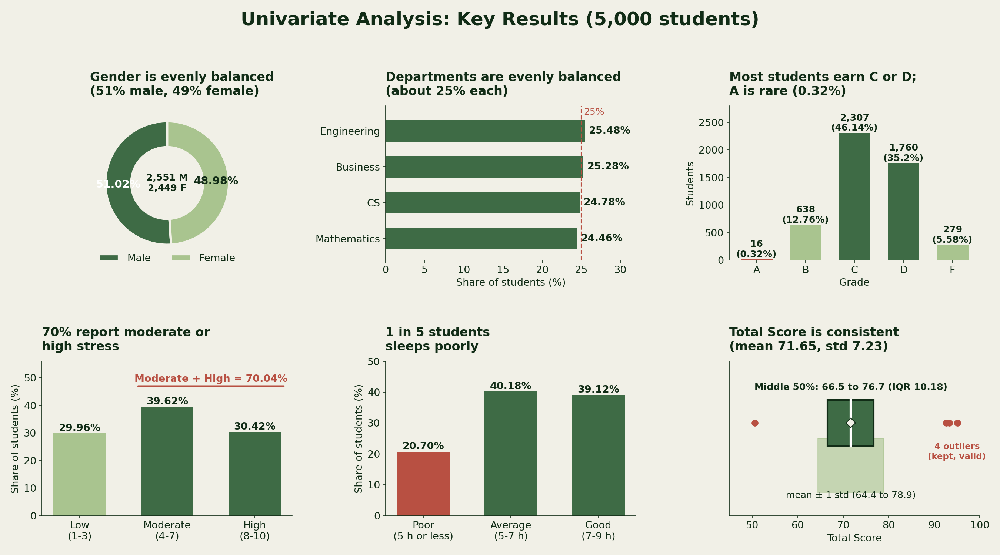
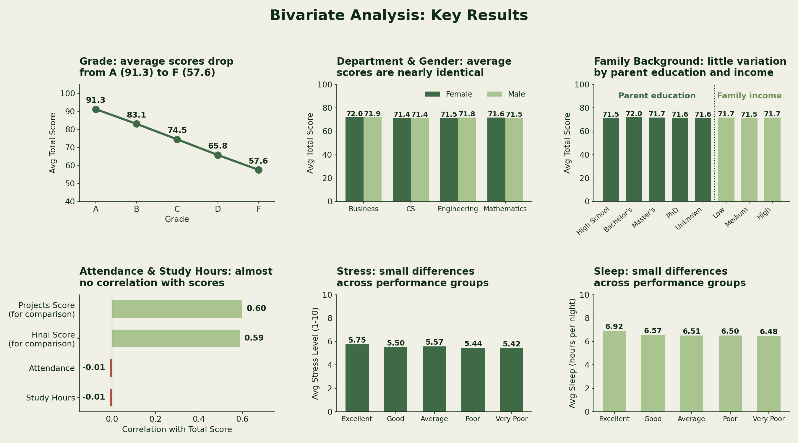
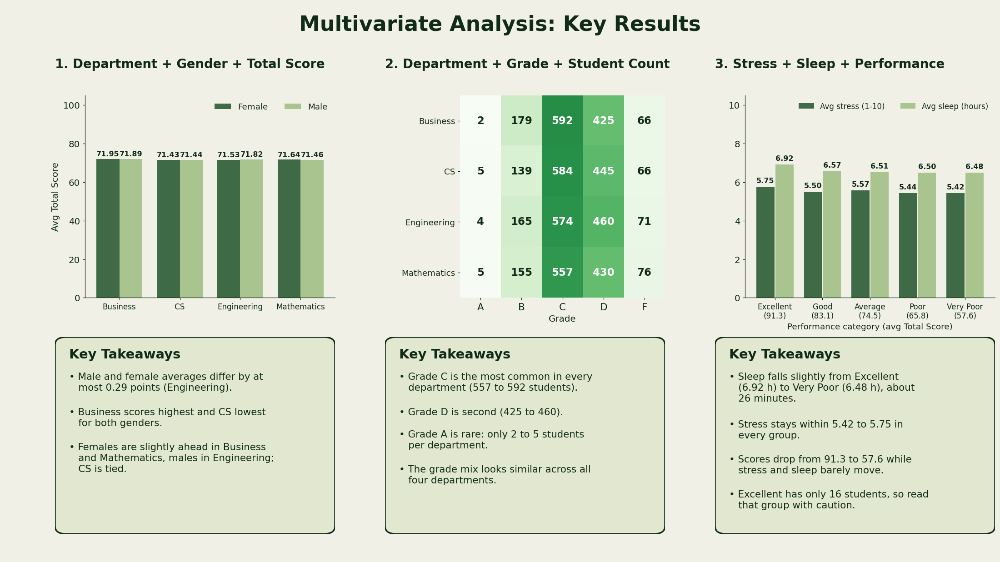
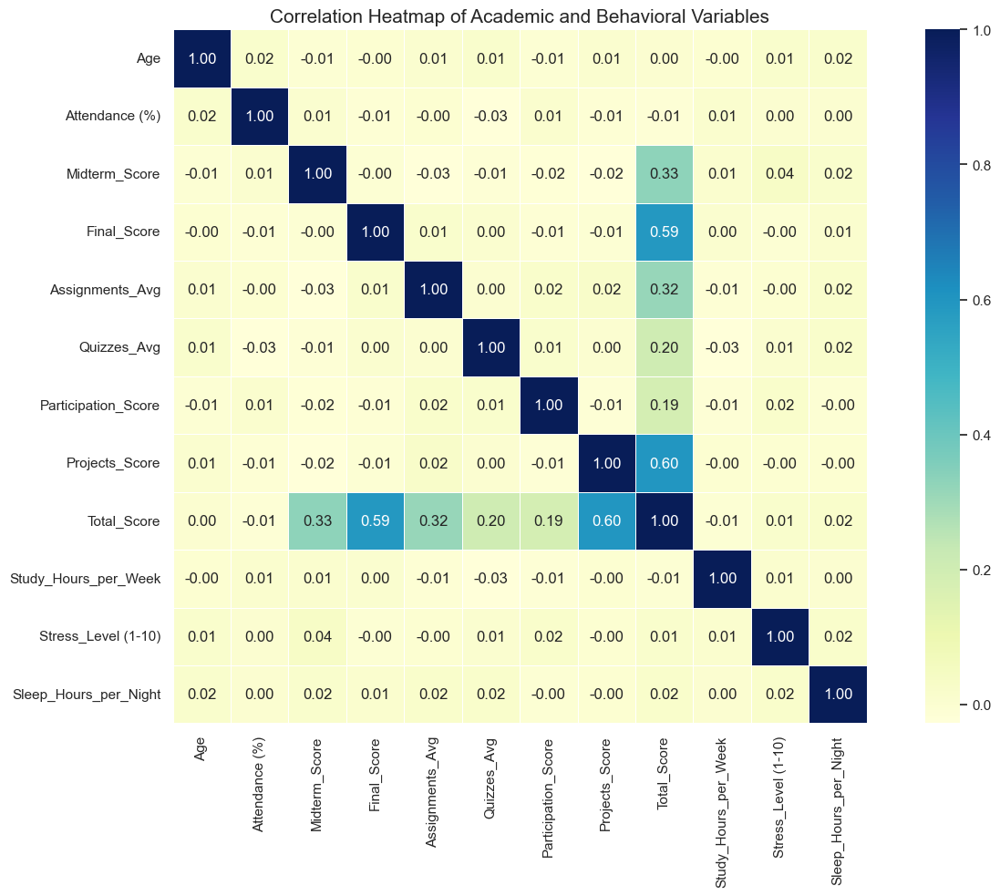

# Student Performance & Behavior Analysis

End-to-end data analytics project that explores which academic and behavioral factors are linked to student performance, using **Python, SQL, Power BI and Excel**.

## Project Overview

| | |
|---|---|
| **Goal** | Understand how scores, attendance, study habits, stress and sleep relate to student performance |
| **Dataset** | [Students Performance Dataset (Kaggle)](https://www.kaggle.com/datasets/mahmoudelhemaly/students-grading-dataset) |
| **Size** | 5,000 records x 23 columns (29 columns after adding derived features) |
| **Tools** | Python (Pandas, NumPy, Matplotlib, Seaborn, Plotly), SQL, Power BI, Excel |

## Repository Contents

| File | Description |
|---|---|
| [Data Analytics Final Project -Python notebook.ipynb](Data%20Analytics%20Final%20Project%20-Python%20notebook.ipynb) | Complete Python analysis: cleaning, EDA, statistics, visualizations and insights |
| [Data Analytics Final Project-SQL.sql](Data%20Analytics%20Final%20Project-SQL.sql) | SQL queries used for analysis |
| [Data Analytics Final Project- Dashboard.pbix](Data%20Analytics%20Final%20Project-%20Dashboard.pbix) | Interactive Power BI dashboard (open with Power BI Desktop) |
| [Data Analytics-Final Project Report.pdf](Data%20Analytics-Final%20Project%20Report.pdf) | Detailed project report |
| [Data_Analytics_Final_Project-_Presentation.pptx](Data_Analytics_Final_Project-_Presentation.pptx) | Project presentation slides |
| [Students Performance Dataset.csv](Students%20Performance%20Dataset.csv) | Raw dataset from Kaggle (5,000 rows, 23 columns) |

## Workflow

1. **Data loading and overview:** shape, data types, `head()`, `info()`, `describe()`
2. **Data cleaning and preprocessing:** handled 1,025 missing values in `Parent_Education_Level`, checked duplicates (none found) and data types, validated outliers (4 valid Total Score outliers kept)
3. **Derived columns:** Full Name, Age Group, Attendance Status, Performance Category, Stress Category, Sleep Category
4. **Exploratory data analysis:** univariate, bivariate and multivariate analysis using 7 pivot tables, 19 groupby summaries, statistical summaries (mean, median, std, CV, IQR) and a 12-variable correlation matrix
5. **Visualization:** 20+ charts using Matplotlib, Seaborn and Plotly
6. **Insights and recommendations:** key findings summarized in the notebook, report and presentation

## Key Visuals

### Univariate analysis


### Bivariate analysis


### Multivariate analysis


### Correlation heatmap


## Key Insights

- **Assessments matter most:** Projects (r = 0.60) and Final Score (r = 0.59) have the strongest link to Total Score.
- **Grades separate scores clearly:** average Total Score falls from 91.3 (Grade A) to 57.6 (Grade F).
- **Most students are mid-range:** Grades C and D make up about 81% of students; only 16 students (0.32%) earned an A.
- **Demographics make little difference:** department averages range only from 71.43 to 71.92, and male and female averages are 71.66 and 71.64.
- **Attendance and study hours do not predict scores:** both show a correlation of about -0.01 with Total Score.
- **Stress and sleep differ only slightly** across performance groups; 313 students (6.26%) combine poor sleep with high stress.

## Recommendations

- Strengthen support for project work and final-exam preparation, the components most tied to results.
- Look beyond attendance and study hours alone when identifying at-risk students.
- Offer wellbeing support to students with poor sleep and high stress.
- Improve collection of parent education data.

## How to Run

```bash
git clone https://github.com/aryar96/Data-Analytics-Final-Project-STUDENT-PERFORMANCE-BEHAVIOR-ANALYSIS.git
cd Data-Analytics-Final-Project-STUDENT-PERFORMANCE-BEHAVIOR-ANALYSIS
pip install -r requirements.txt
jupyter notebook
```

Open the Python notebook and run all cells. Keep the dataset CSV in the same folder as the notebook.

## Author

**Arya R** | [LinkedIn](http://www.linkedin.com/in/arya-r96) | [GitHub](https://github.com/aryar96)
